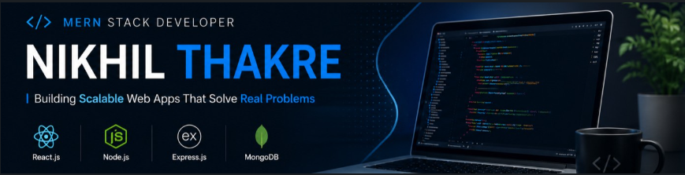

<h2 align="center">Hi, I'm Nikhil Thakre 👋</h2>

<h3 align="center">MERN Stack Developer | Full Stack Developer</h3>

  Building • Learning • Growing

---

### 👨‍💻 About Me

I'm an aspiring Full Stack Developer passionate about building practical, responsive, and user-friendly web applications.

- 💻 Working with React.js, Node.js, Express.js and MongoDB.
- 🚀 Interested in developing REST APIs and full-stack applications.
- 📚 Continuously learning new technologies and improving my skills.
- 🎯 Looking for entry-level Full Stack / MERN Stack opportunities.

### 🛠️ Tech Stack

**Frontend**

JavaScript · React.js · HTML5 · CSS3 · Bootstrap · Redux

**Backend**

Node.js · Express.js · REST APIs · JWT Authentication

**Database**

MongoDB · Mongoose · MySQL · PostgreSQL · SQL

**Tools**

Git · GitHub · VS Code · Postman

### 🚀 Featured Projects

| Project | Description | Technology |
|---|---|---|
| Food Delivery Application | Full-stack food ordering application with customer and admin modules | MERN |
| Ashion Ecommerce | Fashion ecommerce frontend with product browsing and wishlist | React.js |
| Taxi Booking API | REST API for taxi booking and management | Node.js |
| Weather Application | Weather application with real-time API integration | JavaScript |

### 📊 GitHub Activity

### 🤝 Let's Connect

- 💼 [LinkedIn](https://www.linkedin.com/in/nikhil-thakre-08a061183/)
- 📧 [Email](mailto:thakrenikhil33@gmail.com)
- 💻 [GitHub](https://github.com/iamnikhilthakre/)

---

  <i>Building, learning, and improving one project at a time.</i>

